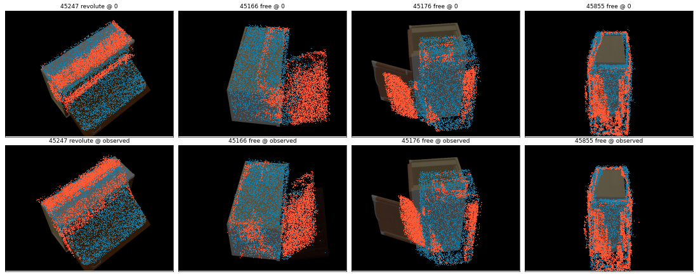

# Interactive articulated model — v1 results

**Date:** 2026-10-05 · **Branch:** `articulated-sfm` · **Spec:** `docs/superpowers/specs/2026-10-05-articulated-model-viewer-design.md`

## What exists now
- `python3 build_model.py --out_dir outputs/artsfm/<obj> [--data_dir …]`, or `run_articulation.py … --build_model`, writes `<obj>/model/`:
  - per-link dense point clouds;
  - convex hulls;
  - `model.json` with the joint, motion, up vector and GT frame.
- `python3 app_articulation.py --root outputs/artsfm --port 7861` launches the gradio viewer:
  - model picker;
  - joint slider (degrees or units), with an option to go past the observed range;
  - Play sweep;
  - RGB or by-part colours;
  - hull toggle;
  - Export URDF, which zips the package and runs the MuJoCo check.
- `python3 -m artsfm.urdf <model_dir> [--use_gt_frame] [--scale S]` exports a GaussianArt-convention URDF and checks it in MuJoCo.

## Real models (dense labelling, cached MASt3R matches, CPU)

| object | joint | body pts | part pts | fallback | unlabelled | warnings | build time |
|---|---|---|---|---|---|---|---|
| 45247 | revolute | 441,183 | 178,576 | 210,899 | 50,659 (7%) | — | 51 s |
| 45166 | free | 355,154 | 141,987 | 242,850 | 160,117 (24%) | screw → no URDF | 50 s |
| 45176 | free | 373,966 | 95,613 | 169,450 | 30,909 (6%) | screw → no URDF | 2 m 30 s |
| 45855 | free | 85,291 | 33,796 | 225,241 | 202,284 (63%) | many unlabelled; screw → no URDF | 1 m 10 s |

Counts are before fusion. Each saved link cloud is voxel-downsampled to at most 150k points.

**URDF:** 45247 exported in its own frame, with gravity from the averaged camera up vectors and reconstruction scale (`python3 -m artsfm.urdf outputs/artsfm/StorageFurniture_45247/model`).
- The MuJoCo check passes. After the review fix it compares the mesh vertices MuJoCo actually loaded, at both joint limits, against the model's motion.
- Do **not** use `--use_gt_frame` for 45247 or 45176. Their GT Sim(3) alignment is broken (see below), so the up vector and scale it supplies are wrong. A passing MuJoCo check cannot detect that, because it verifies that the URDF matches the model, not that the model matches reality.

## Labelling quality

Against the camera-frame GT meshes, after Sim(3) alignment:

| object | body acc | part acc | median dist to GT surface |
|---|---|---|---|
| 45247 | 1.00 | 0.00 | 1.9 (alignment broken) |
| 45166 | 0.87 | 0.79 | 0.10 / 0.23 |
| 45176 | 1.00 | 0.00 | 0.9 (alignment broken) |
| 45855 | 0.91 | 0.19 | 0.05 / 0.06 |

The GT numbers are only meaningful where points land on the GT surfaces. On 45247 and 45176, the median distance is about 1–2 object sizes. There the GT alignment, not the labelling, has failed (as with 45247's `cam_align_rmse` of 0.64 in the factorization run), and every point is "nearest" the static mesh.

The alignment-free check is below. Labelled points are drawn on each object's reference photo; the model frame *is* that camera's frame. The top row is joint = 0, the bottom row the observed value. Blue is body, red is part.

- **45247:** the lid and box body separate cleanly along the lid edge.
- **45166:** the open door is separated from the body.
- **45176:** the left door is correct, but a vertical strip on the right side is wrongly labelled part.
- **45855:** the joint itself is wrong (prismatic detected as free), so the dense labels are noisy. Labelling can only be as good as the joint it is given.

## Known limits
- **URDF visuals and collisions are convex hulls**, so they look blocky. Textured meshes are step 2, with no format change.
- **`free` (screw) joints** animate in the app but cannot be exported to URDF.
- **Scale** is the reconstruction's own unless `--scale` or `--use_gt_frame` is given.
- **Gradio Model3D** re-sends the whole `.glb` (~4 MB) on each slider release, which is fine locally. Its camera may reset between updates.
